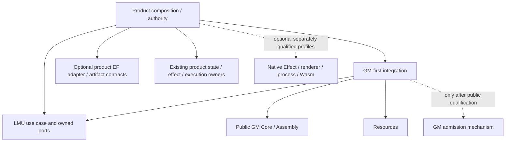

# Continuous evolution as the greenfield architecture objective

**2026-11-23: owner direction and critical research recommendation, not an
accepted production API.** The owner wants to explore a much broader target
than occasional plugin hot replacement: a system capable of continuing useful
work while its software evolves. New products are greenfield in the owning
`agent-teams-ai` repositories. The legacy
[777genius/agent-teams-ai](https://github.com/777genius/agent-teams-ai)
is a behavior/UX/compatibility reference, not the target implementation or
default adoption consumer. Do not modify it for this research. Existing
explicitly accepted migration/compatibility decisions remain with their
owners; they are not new implementation authorization.

This document refines the earlier [foundation strategy](foundation-strategy-review-2026-11-23.md).
It corrects the interpretation of "not everything needs hot replacement":
do not set an artificially narrow *long-term* scope because today's JS
mechanisms are limited. Preserve the previous experiments and actual negative
controls. Q1-Q7, public admission, product feature selection and first
production bootstrap remain open.

**2026-11-24 navigation update:** the owner requested structured foundation
plans, parallel critique and headless reuse with optional declarative UI. The
[application foundation](application-foundation.md),
[headless/UI proposal](headless-plugins-and-ui.md) and
[delivery plan](../plans/foundation-delivery-plan.md) turn this vision into
bounded work and explicit acceptance. They retain the long-term ambition and
the original evidence below without selecting the remaining production defaults.

**2026-11-24 successor clarification:** shared foundation qualification starts
with representative fixtures and independent test Hosts, not an implemented
first application. Browser, Desktop and untrusted plugins are confirmed
architecture targets now. The [qualification matrix](../research/foundation-qualification-matrix.md)
records the current route. Product-adoption rows and source comparisons below
remain dated evidence; they do not reintroduce a product-first entry gate.

## 1. The thesis: replaceable software as a competitive capability

The strategic aim is **continuous evolution of the whole useful application**,
including backend, frontend, and eventually its own host/foundation. Every
meaningful owned capability should be designed with an upgrade path. Aim for
independently replaceable coherent units wherever compatible with its
invariants; keep widening the verified coverage over time. A currently
unsupported fine-grained transition is a recorded research gap, not a
permanent exclusion from that vision.

This is a research hypothesis about a future bottleneck, not a prediction
that all software will use dynamic modules.

- The September 2026 revision of [NBER Working Paper 35275](https://www.nber.org/papers/w35275)
  studies more than 500,000 GitHub developers with AI usage telemetry. Its
  matched-event estimates for autonomous coding tools report a 240% cumulative
  effect on commits, versus 30% for releases; the authors identify attenuation
  along the delivery chain. Observational estimates are not a causal proof
  that hot updating fixes that bottleneck, and their marketplace observations
  do not show total usage increasing. More releases are not necessarily value.
- [DORA 2025](https://dora.dev/research/2025/dora-report/) emphasizes that AI
  amplifies the strengths and weaknesses of the delivery system. Architecture,
  independently verified contracts and fast feedback are leverage, not merely
  more generated source.
- [METR's 2026-02-24 update](https://metr.org/blog/2026-02-24-uplift-update/)
  explicitly reports selection and measurement problems in its later
  productivity experiment. The early study found slower completion with
  early-2025 tools; the later estimates are weak evidence about effect size.
  Do not promise a specific improvement, extrapolate model capability, or
  interpret commit volume as product value.

**Our hypothesis:** if generating and checking candidate changes becomes much
cheaper, a system that can admit verified small changes quickly, preserve
ongoing work, and recover safely can compound the benefit. It has useful
properties even if AI acceleration disappoints: explicit contracts, controlled
independent release, lower disruption, bounded blast radius and reversibility
where the owner actually supports it. The payoff may be largest in long-lived
agent teams, workspaces and self-hosted desktop installations rather than
stateless web services already served well by ordinary rollout.

### Why this is not simply another plugin platform

A plausible differentiated product experience: agents produce an improved
feature, run independent qualification, show the exact affected capability
closure and compatibility consequences, stage it in a disposable environment,
obtain authorization, and let the existing application admit the successor.
Ongoing sessions, editor work, and unrelated features remain useful. Failed
candidates cannot destroy the recovery path. A whole product may evolve
without all of its processes or clients being simultaneously restarted.

This is *not* uncontrolled self-modification or auto-approval of generated
code. Keep candidate generation, independent review/conformance, artifact
provenance and actual activation authority distinct. ReviewRouter, existing
CI, Engineering Foundation and the artifact admission owner are the places
to reuse evidence and authorization, not mechanisms to reimplement in LMU.
A model-written test, a green build or an artifact signature alone is never
authority to execute or change production.

## 2. Prior art: the ambition has serious roots, and real limits

Source observations below are not new native experiments or competing product
scores. Each comparison contributes a falsifiable property, not a dependency.

| Source | Strong idea worth preserving | Where the analogy stops |
| --- | --- | --- |
| [Kitsune, TOPLAS 2014](https://doi.org/10.1145/2629460) | Whole-program dynamic updates in C with explicit update points and programmer-directed state transformation; authors report six evaluated programs | Does not establish arbitrary TS closure, event-loop, UI, persistent data or distributed-effect compatibility. The coarser whole-program unit is evidence against assuming per-function update is always better. |
| [Erlang/OTP release handling](https://www.erlang.org/doc/system/release_handling.html) | Both simple code replacement and synchronized state transition with explicit upgrade/downgrade instructions; unaffected processes can continue | Complex dependency/order and state issues still exist. [Core runtime upgrade](https://www.erlang.org/doc/system/upgrade.html) requires an emulator restart. Whole-system evolution need not imply every runtime frame is patched. |
| [Component reconfiguration survey, ACM 2023](https://doi.org/10.1145/3595376) | Version consistency for distributed transactions improves on purely local quiescence criteria; hierarchical reconfiguration needs explicit communication/liveness assumptions | Do not adopt a distributed transaction model or algorithm by analogy. A real product operation and its compatible dependency/effect basis must be defined and proved. |
| [Unison content-addressed code](https://www.unison-lang.org/docs/the-big-idea/) | Definition identity includes references to dependency hashes; old and new definitions can coexist | A language-level term hash is not a portable JS runtime identity, grant, or state owner. Reuse existing immutable plan/artifact/closure identities rather than inventing another hash language or compiler. |
| [WebAssembly Component Model WIT](https://component-model.bytecodealliance.org/design/wit.html) and [WIT resource specification](https://github.com/WebAssembly/component-model/blob/main/design/mvp/WIT.md) | Named imports/exports and explicit owned versus borrowed handles provide a potential future language-neutral component boundary | A compatible interface does not migrate opaque resource handles or prove effects/revocation/termination. Wasm remains a separately qualified profile, not a mandatory replacement for ordinary TS. |
| Earlier native Nginx, Piral, Effect, Get Modular and browser evidence | Multiple retained generations, exact ownership, public scope/entry identity, independent client/server compatibility, real failure controls | The [current evidence](../research/public-runtime-identity-and-safe-drain-2026-11-23.md) and [cross-tier evidence](../research/cross-tier-version-skew-2026-11-23.md) do not implement the full operation or qualify a product. |

The useful synthesis is a *version-coherent operation* and an upgradeable
hierarchy rather than trying to patch every execution frame. Do not hard-code
one irreversible unit of replacement into the public contract.

## 3. Target wide coverage without confusing granularity

These are capability profiles to investigate, not adopted enum values or
mandatory lifecycle hooks. Each has an actual observable completion criterion.

| Scope of change | Possible realization | Evidence needed |
| --- | --- | --- |
| Data, configuration, already-interpreted policy | Versioned data and stable state/read owner | Valid revision, authorized activation, coherent reads, no accidental new executable authority |
| Pure algorithms, parsers, model/strategy selection | Replacement of the owning capability or compiled implementation; finer linking/selection later if useful | Same semantic contract, affected closure, independent output oracle |
| Local backend feature / sub-feature | Prepared composition, atomic admitted-route change, retained old operation | Actual public admission, nested continuation, state/resource safety; obey FMS parent visibility and republication |
| UI capability, editor or workspace surface | Native mount/remount or a stronger state handoff; preserve meaningful user intent in its actual owner | Dirty data, focus, selection, undo/redo/IME where promised, actual old/new useful output and asset/contract compatibility |
| Long-lived actor/agent/stream | Retain old code cohort; checkpoint or owner-qualified handoff to successor | Actual operation identity, continuation/effect authority, no lost/duplicate work, native settlement |
| Native module, language runtime, local host or distributed role | Replacement of isolated process/realm/replica with compatible state and routing handoff | Recovery and stop proof at the actual boundary; no implication of physical in-process unload |
| Recovery/bootstrap itself | Upgrade through an outer trusted owner, verified new artifact and recoverable prior route | No candidate can replace its sole recovery authority while relying on it; compatible recovery remains available |

Ultimate **coverage target**: every substantive product capability, including
foundational capabilities, has a documented and eventually qualified upgrade
path. The target is not that every function, source file, DOM node or package
must be individually hot-replaceable. We can aim for finer independent
replacement than today without turning every helper into a runtime object.

The minimum granularity is not globally fixed: start with the smallest
coherent unit whose contract, state and dependency closure are explicit.
If a future compiler/loader supports verified finer replacement, reduce
the unit without changing business code or inventing a second dependency
graph. If compatibility forces several components to change together,
expand the affected cohort, not the whole application by default.

The FMS hierarchy (module, feature, sub-feature), composition entry/group,
physical package/artifact and deployment unit remain separate dimensions.
A private sub-feature cannot gain ambient root visibility in the name of
hot replacement. Parent-owned republication and composition can provide a
future independently managed seam when its owner has evidence.

### A target architecture that can change its own foundation

The stable root in a running instance is a *relative* stability boundary, not
an eternal implementation. React runtime, admission kernel, SDK, main process,
preload, native addon and even the bootstrap can evolve through a supported
outer update path. Every transition needs some authority not destroyed by
that transition. An outer process/installation/deployment owner can replace
the inner foundation; the actual outer recovery mechanism also has a
separately governed upgrade path. No infinite tower of generic supervisors.

Thus "the whole system can change" is compatible with a bounded local
implementation. It does not mean simultaneously modifying the code executing
an unfinished publication, or guaranteeing that irreversible schema changes
and security revocations are always zero-interruption.

### Two costs to actively attack

1. **Combinatorial compatibility.** N independent A/B switches admit up to
   2^N nominal version combinations. No product can safely promise arbitrary
   combinations solely because pairwise contracts parse. Maintain only
   owner-supported cohorts, explicitly validate whole affected closure and
   membership, and use compatible Published Languages for independent domains.
   A single root per process is not a global lock; a safe mixed-version
   operation can have a coherent semantic contract across different releases.
2. **Version retention.** Frequent release with old streams/offline clients
   can accumulate code, handles, caches and receipts without bound. Existing
   native evidence shows A/B/C coexistence and non-FIFO retirement. Bound
   retained generations, staged work, artifact bytes and recovery horizons
   independently; refuse/defer unsafe replacement or renew a compatible realm
   instead of losing work. Fine-grained logical swaps do not prove JS unload.

## 4. Concrete technical foundation: build on Get Modular, not next to it

The previous "optional Get Modular integration" language described portability
of the standalone architecture. For the organization's greenfield default,
**recommend one GM-first ordinary TypeScript reference implementation**.
Do not spend the first delivery implementing a second fixed-factory composition
engine to demonstrate neutrality. Ordinary TS means no mandatory Effect;
it is compatible with using Get Modular at the real composition boundary.
Pure update policy and product ports stay inward and free of GM-specific
imports. The first working integration uses the existing public packages
in its outer composition/adapters. This is a proposed dependency decision,
not an adoption of a newer package pin by another repository.

| Existing component | Proposed use inside the first reference path | Availability / explicit limit |
| --- | --- | --- |
| `@get-modular/core` | Consume its declarations, explicit bindings and immutable plan/digest; invoke compiler at composition boundary | Public 0.8.0 cohort exercised in P1-P12. No second graph/resolver. Exact consumer pin/admission separately required. |
| `@get-modular/assembly` | Prepare/run already selected factories with closed dependency records and actual borrowed inputs | Public 0.8.0. Slot-free borrowed inputs only; no arbitrary incremental graph reuse. |
| `@get-modular/resources` | Own registered acquisition/cleanup flights and debts for actual candidate resources | Public 0.2.2. Not admission, automatic drain, or native stop. Explicit drain barrier before close. Pure borrow-only capabilities do not need a scope. |
| `@get-modular/lifecycle-kernel` | First upstream candidate for local generation/lease admission; qualify actual atomic route+admit and admitted continuation mechanism under its owner | Source 0.1.0 private. **No supported public release today.** Must not import or copy private source. No new parallel kernel in LMU. |
| `@get-modular/observation` | Optional latest-state view/query publication and stale-load handling in relevant client/host adapter | Source manifest 0.2.1; exact required released cohort and actual browser path separately qualify. Not a durable event feed or invocation fence. |
| `@get-modular/effect` | Optional future native driver preserving Layer/Scope/Stream, error and environment semantics | Separate profile, exact installed peer and runtime evidence required; no Promise facade or second decision engine. |
| Extension Foundation | Verified artifact/admission and lifecycle protocol mapping in the actual product adapter; reuse distribution and trust | Current repository is architecture foundation, no public runtime SPI/production package delivered. Core must not require its future implementation or organization credentials. |
| Agent Runtime / Orchestrator | Product-owned integrations for session/operation and business effect authority | Their own accepted context, pins, deployment and recovery rules; no dependency on either in neutral LMU core. |
| Engineering Foundation / FMS | Development-only architecture, package and conformance checks, CI/review | Never a runtime import. Reuse existing toolgraph; do not construct another conformance platform. |

Pinned source authorities:
[GM system boundary](https://github.com/agent-teams-ai/get-modular/blob/850bac5fd02fa5697846cc8958ac447d5c2ee7bb/docs/architecture/system-boundary.md),
[ADR-0029](https://github.com/agent-teams-ai/get-modular/blob/850bac5fd02fa5697846cc8958ac447d5c2ee7bb/docs/decisions/0029-admit-an-optional-lifecycle-kernel-candidate.md),
[ADR-0030 Resources](https://github.com/agent-teams-ai/get-modular/blob/850bac5fd02fa5697846cc8958ac447d5c2ee7bb/docs/decisions/0030-admit-the-module-resource-scope-package.md),
[ADR-0031 Assembly inputs and scope](https://github.com/agent-teams-ai/get-modular/blob/850bac5fd02fa5697846cc8958ac447d5c2ee7bb/docs/decisions/0031-pass-a-per-run-scope-and-declared-inputs-to-assembly-runs.md),
[ADR-0034 Observation](https://github.com/agent-teams-ai/get-modular/blob/850bac5fd02fa5697846cc8958ac447d5c2ee7bb/docs/decisions/0034-admit-the-module-change-observation-package.md),
[kernel private manifest](https://github.com/agent-teams-ai/get-modular/blob/850bac5fd02fa5697846cc8958ac447d5c2ee7bb/packages/lifecycle-kernel/package.json),
[EF boundary ADR-0015](https://github.com/agent-teams-ai/extension-foundation/blob/70f2bf21203b557e0f5a3b563a6b41eec5925fd8/docs/decisions/0015-authorize-get-modular-semantic-extraction.md),
[EF current README](https://github.com/agent-teams-ai/extension-foundation/blob/70f2bf21203b557e0f5a3b563a6b41eec5925fd8/README.md),
[organization library-first rule](https://github.com/agent-teams-ai/.github/blob/0b44c64c824f536bd1b085341e7669bcc64ef124/docs/engineering-quality-standard.md#library-first-design-and-deliberate-evolution),
[FMS v1.1](https://github.com/agent-teams-ai/.github/blob/0b44c64c824f536bd1b085341e7669bcc64ef124/docs/architecture/feature-module-standard/v1.1.md).

**Important supersession:** GM ADR-0030 supersedes ADR-0028 in full; it withdraws
the old ownership package, K1 and S3/G1/K1 sequence. Do not revive them by
quoting historical ADR-0029 prose. ADR-0029's surviving candidate-only/public
qualification conditions still apply. Resources and kernel are complementary:
the scope is cleanup, kernel is synchronous bookkeeping. The actual public
admission gap cannot be closed by a documentation proposal or moving code.

### Source dependency direction, not a deployment diagram

Keep one cohesive initial library release boundary. The above are source-layer
responsibilities, not instructions to create seven npm packages. The inner
operation owns semantic decisions, ports and receipt interpretation. GM
imports stay at the actual composition/integration seam under the applicable
Consumer Module Standard. A real packed consumer must prove emitted public
declarations and exports, absence of unwanted optional/runtime imports and
a single compatible physical Assembly/Resources identity. Choose exact
dependencies versus peers using actual public handles and install-cohort
evidence; peerDependencies alone cannot guarantee one runtime instance.
Do not bundle a hidden second copy.

The independent public library may later offer another actual composition
integration if demanded and qualified, or allow a consumer to supply already
resolved typed capabilities. Do not copy the GM resolver just to avoid an
external dependency; no unsupported portability claim. Neutrality means
product-independent semantics and supported seams, not equal implementation
effort for every hypothetical host.

### What LMU itself contributes, and what it must delegate

LMU is a reusable application use case, not a new general runtime kernel.
It coordinates an explicitly supported transition using existing primitives:

| Step | Single responsible primitive | LMU's distinct work |
| --- | --- | --- |
| Plan | GM graph; EF/owner verified artifact and policy facts | Bind requested guarantee, actual affected closure and readiness basis; reject unsupported transition |
| Stage | Selected native loader, GM Assembly, Resources | Coordinate candidate attempt and custody established before code/acquisition; preserve failed candidate receipts |
| Publish | Product-owned canonical expected-revision and local route/admission primitive | Invoke the qualified atomic boundary with original attempt identity, classify/refuse stale or ambiguous result |
| Reconcile | Authority/receiver's original receipt and actual current head | Orchestrate recovery without blind replay or deleting possibly active successor |
| Adopt/drain | Actual view/service/operation owner and supported local admission mechanism | Coordinate useful adoption and retention; do not manufacture work completion from a timeout |
| Retire | Actual resource/executor/artifact owner | Request safe cleanup after prerequisites; record original debt/holds and reconcile observed disposition |

Avoid a 25-hook SPI which forces every consumer to reimplement the same
process. Design the inner operation around a few *cohesive* qualified ports
and selected profiles, then measure the actual consumer glue. The port shape
remains open. A phase name is not a package, a second manager, a separate
service or an aggregate by default. Product authority retains the canonical
head, grants, business state and effect receipts; operation progress may
reference those facts without maintaining independent writable copies.
A durable profile can use a product-owned transaction/attempt store and
existing workflow machinery; the ephemeral profile does not need an
artificial database/outbox. Do not create a global cross-tier lifecycle FSM.

There is one real unresolved substrate decision. The existing kernel can
stage/activate/quiesce/retire exact identities but does not select the
canonical route, admit a whole nested operation or guarantee arbitrary
continuations. Assess a host-owned non-yielding select+admit over the existing
kernel *without* a second lease registry. If that composition cannot express
the supported nested-work contract, propose the minimum change at the GM
owner with the actual falsifying case and successor decision. Qualify the
existing package through its surviving delivery gates, not a private import.
Do not move publication authority into GM to simplify the API.

### Alternatives and counterarguments

| Alternative | Strength | Disqualifier / disposition |
| --- | --- | --- |
| Implement the whole updater in GM | One distribution and less navigation | Violates its current narrow graph and lifecycle-bookkeeping authority; would mix product-neutral composition with operational policy. Requires a real owner boundary change, not a convenience import. Reject for current design. |
| Implement inside EF | Installation/update/revocation terminology already present | EF artifact/trust scope and GM independence would be lost; built-ins and generic OSS need no catalog. Reject a second combined foundation. |
| Separate fully generic LMU with many independent backends immediately | Broad market portability | Highest risk of speculative abstraction and duplicate composition, scope and transition logic. Defer additional drivers to proven demand. |
| Separate LMU, one actual GM-first reference path | Reuses existing foundation with narrow policy separation and one common operation | Depends on real public admission qualification; cannot yet ship a full dynamic path. Recommended for evaluation. |
| No LMU; every product coordinates its existing mechanisms | No extra library/package | May be best if no common meaningful operation is proved, but duplicates the same coordination in intended greenfield consumers. Keep this as the value baseline. |

The owner's existing standalone library direction is preserved. The first
delivery must falsify the value of the shared operation against an ordinary
static/rolling implementation, not justify its existence by code volume.

## 5. Greenfield adoption and an extensible architectural contract

New product design starts at the actual owner repository, not the legacy
application. Orchestrator [ADR-0117](https://github.com/agent-teams-ai/agent-teams-orchestrator/blob/c6ce98cd1a8ac1dd27ec877c018e5aa7cd5adff7/docs/decisions/0117-reconcile-mandatory-module-composition.md)
already mandates GM for applicable assembled/replaceable/configurable TS
capabilities, with exact current 0.5.0 Core/Assembly baseline and no automatic
dynamic kernel admission. It rejects artificial entries for pure helpers.
[Implementation readiness](https://github.com/agent-teams-ai/agent-teams-orchestrator/blob/c6ce98cd1a8ac1dd27ec877c018e5aa7cd5adff7/docs/architecture/implementation-readiness-gates.md#module-foundation-before-business-expansion)
names the existing Sandbox Manifest seam and pending module gates.
[ADR-0103](https://github.com/agent-teams-ai/agent-teams-orchestrator/blob/c6ce98cd1a8ac1dd27ec877c018e5aa7cd5adff7/docs/decisions/0103-first-sandbox-runtime-migration-slice-admission.md)
bounds the sandbox feature admission, not general dynamic replacement.
Agent Runtime has distinct execution ownership and its own exact pins.
Orchestrator [OD-042](https://github.com/agent-teams-ai/agent-teams-orchestrator/blob/c6ce98cd1a8ac1dd27ec877c018e5aa7cd5adff7/docs/open-decisions/OD-042-frontend-extension-contribution-model.md)
and OD-043 still own open frontend/lifecycle decisions.

A new candidate worth evaluating is the greenfield sandbox manifest/observation
query boundary with the actual owning context and, when selected, a new
frontend projection of the same authorized facts. This is a proposed
qualification candidate, not permission to implement a product slice, pick a
framework, repurpose existing admission or change contract versions. Start
with actual owner selection; a new disposable read-oriented fixture does not
count as a real product adoption. The legacy recent-projects findings are
only rejecting/positive examples to inform the new design.

Propose a **replaceability evidence dossier** for each substantive feature
or owner cohort, derived where possible from existing FMS/GM/EF/product
artifacts. Reuse the [existing authoring dossier](operation.md#eligible-module-authoring);
do not create a parallel manifest schema or mandatory boilerplate per helper.
Record intended independent-update boundary, supported mechanism/limits,
immutable identity and actual dependency closure, owner/state compatibility,
admitted operation and lifetime, readiness/rollback/recovery oracle, and
scope-specific evidence. An explicit unsupported or coarser update path
is useful backlog data, not a permanent exemption. Do not amend immutable
FMS or auto-adopt a new local profile from this research.

### Growth roadmap and falsification

| Gate | Discriminator | Do not count as success |
| --- | --- | --- |
| G0 | One accepted greenfield owner, qualified GM public admission path, exact compatible dependency/artifact and bootstrap evidence | Private kernel, passing source inspection, or legacy refactor |
| G1 | Real small backend capability A/B, old admitted work and nested/stream boundary, failed candidate/late completion, shared owner survives | Toy router as production admission, unregistered side effects |
| G2 | Real new frontend contribution and compatible backend contracts, meaningful dirty-state and old-client behavior, independent target qualification | Browser fixture alone, React mount or successful import |
| G3 | Two independent greenfield adopters of the shared operation and one actual multi-module change | Copying consumer hooks/state machines or shared implementation oracle |
| G4 | Actual long-lived work and deployment/realm renewal with recovery; repeated changes at declared workload, independent domains | Small test timings as scale proof, permanent retention, no physical stop evidence |
| G5 | Finer-grained replacement and separately qualified isolated/native/Wasm delivery, if supported by real need | Universal dynamic import, blanket plugin containment, arbitrary state transfer |
| G6 | Verified AI-assisted candidate-to-useful-update workflow with independent policy/review, bounded activation and recovery | Model-authored code/tests auto-approved or faster commits treated as shipped value |

The roadmap is a long-term objective with explicit gates, not six new
subsystems to create. Stage G0/G1 can be done with ordinary TS and existing
primitives; G2 should follow as an independent true frontend/back-end
adoption. Expand only the exact observed missing contracts. No production
code is written now.

## 6. How to know whether the future bet actually wins

Measure an ordinary well-engineered rolling/static baseline and the
same useful change set under the proposed architecture, with equal test,
security, state-continuity and review requirements. Do not handicap the
baseline by requiring full restarts where it already supports graceful
replacement. Track [DORA's five delivery metrics](https://dora.dev/insights/dora-metrics-history/)
and additional user-centered continuity measures.

- Median/p95 time from reviewed candidate to actual useful activation, not
  commit or download; qualification/review/build/stage cost included.
- Change failure and deployment rework, rollback/fix-forward/recovery time;
  unauthorized, duplicate or lost effects and state loss are rejecting
  outcomes regardless of speed.
- User-visible interruption, retained sessions/streams, unsent data loss,
  incompatible client errors and independent feature availability.
- Percentage of *inventory of meaningful owned capabilities* with a declared
  and qualified upgrade path, classified by guarantee; track actually needed
  replacement granularity, not count of plugin packages. Separate a future
  coverage target from today's native evidence.
- p95/p99 request/admission latency, RSS/heap/FD and resource/asset retention
  after repeated replacements, capacity under active work, defer/refuse rate,
  cleanup debt and operational burden. Measure by owner/cohort, not per-agent
  control-plane objects.
- Authoring and integration effort, code duplication, cross-repo changes per
  feature, changed consumer glue, verification time, and maintenance cost.
  Explicitly count the cost of making fine-grained boundaries real.

Set product SLO and budget thresholds before qualification; don't invent
production percentages. Try ordinary, cross-feature and incompatible changes;
preserve negative outcomes, unsupported transitions and unchanged dependencies.
If dynamic replacement does not improve end-to-end user/delivery value after
its safety and authoring cost, prefer the coarser qualified mechanism in that
profile. If the evidence supports finer granularity, promote it without
redesigning business logic. An architecture that can admit a new mechanism
later is more valuable than one frozen into a speculative hot reload runtime.

**Conclusion:** the broad ambition is a legitimate research and competitive
strategy, not a guarantee of future market demand. Pursue it as greenfield
architecture now: library-first, explicit capability contracts, versioned
immutable composition, compatible state/authority, and a verified path to
replace the entire system at progressively stronger boundaries. Reuse the
actual existing components. No additional production dependency, code,
accepted public API, FMS change or product pin is authorized by this document.
