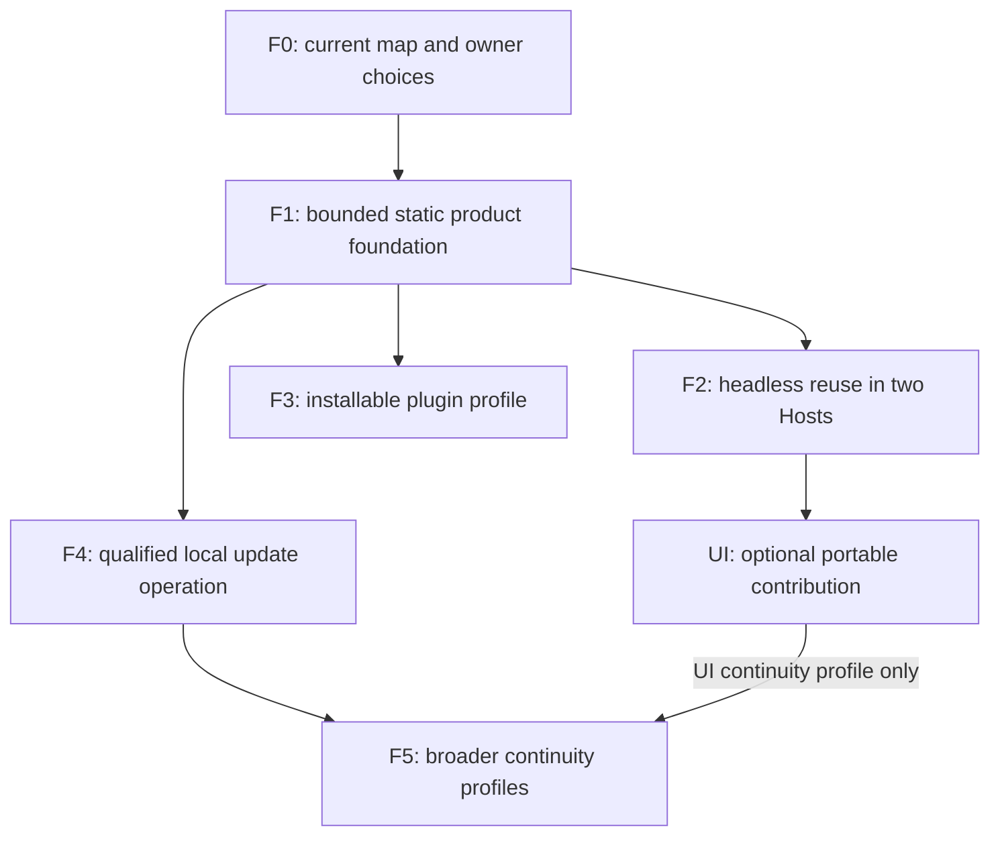

# Foundation delivery plan

Status: proposed implementation sequence, 2026-11-24. The owner authorized this
documentation, research consolidation, independent critique and merge of ready
related work. This plan does not start production runtime implementation,
accept a public API, update consumer pins or close the owner choices below.

## Outcome and working rules

Enable greenfield applications to build useful capabilities on a qualified
module foundation, reuse headless behavior across actual Hosts, and later add
stronger update paths without rewriting business logic or duplicating existing
composition, cleanup, execution and authority mechanisms.

Use [application foundation](../architecture/application-foundation.md) for the
authoring handoff, [headless plugins and UI](../architecture/headless-plugins-and-ui.md)
for portability, [operation](../architecture/operation.md) for complete update
coordination, and [open decisions](../decisions/open-decisions.md) for unresolved
scope. The [status](../status.md) and [evidence map](../research/README.md) identify
what exists today. Accepted upstream contracts and product admission retain
authority over this proposed sequence.

- Start at one real capability and its actual owner. Sandbox Manifest is a
  concrete candidate, not a new adopted LMU consumer or permission for a product
  slice. A different waiting greenfield product can be selected with its own
  acceptance target and admitted scope.
- Use ordinary TS and the applicable public GM composition path first. Do not
  build another resolver, resource stack, lease registry or universal Host.
- Separate research, source implementation, public delivery, consumer
  qualification and production adoption. Merged prose is only delivery of prose.
- Complete the selected operation, including its rejecting cases, before adding
  optional profiles. A small scope retains the real correctness requirements.
- Prefer narrow coherent packages only when actual use, dependency, release or
  deployment boundaries warrant them. Avoid package-per-phase scaffolding.
- Use strict TS 7.0.2+ for maintained JavaScript-runtime work and public-root
  consumer checks; inspect initialized embedded compiler dependencies too.

## 1. Dependencies between claims

These are dependencies of the corresponding claims, not a global serialized
project schedule. F1 does not wait for F3/F4/F5. F2 is required for a claimed
cross-Host reuse profile, not for every installable plugin in one selected Host.
Built-in live replacement need
not depend on an external artifact catalog. An installable plugin can initially
use controlled restart. UI portability can be investigated independently of
backend hot replacement. Two meaningful GM profiles in F1 and two independent
Hosts in F2 are different evidence.

## 2. F0 — current map and decisions

**Owner:** this research/planning workstream with the actual product and package
owners. **Current scope:** authorized documentation work; zero production LOC.

| Work | Exit evidence |
| --- | --- |
| Task-first documentation routes | A new author finds the applicable CMS, product gate, headless boundary and current source status without reading the research chronology |
| Current versus historical authority | Accepted ADRs and pins remain unchanged; dated findings and original failures have explicit destinations |
| First-delivery decision packet | Actual consumer candidates, trust/runtime assumptions, useful outcome, state/resource owner and independent acceptance options are reviewable |
| Relevant open PR audit | Each useful change is merged, reconciled with current authority, or retained with a concrete blocker; no blind merge of old stacked decisions |
| Independent critique | Plan review and exact-content review, material findings corrected and checked again; unresolved policy choices remain open |

F0 is complete as documentation when these artifacts are delivered and reviewable.
It does not require pretending the owner has chosen every production policy.
Keep the first consumer and supported guarantees explicit before implementation
of F1 or F4, as applicable to their owning admission rules.

## 3. F1 — bounded static foundation of one product

**Owner:** selected product; GM and development-tool owners support missing
public or source-check contracts. **Entry:** accepted capability owner and
scope, exact compatible public artifacts and a supported compiler/runtime.

| Work item | Implementation responsibility | Acceptance/rejecting evidence |
| --- | --- | --- |
| F1.1 Inventory real seams | Product composition owner classifies independently assembled capabilities, pure helpers and shared providers | No artificial graph node per helper; no real selected seam left on a competing production composition path |
| F1.2 Reconcile artifact cohort | Product records its accepted versions and any reviewed migration | Packed public imports and emitted declarations resolve; no private kernel/deep imports or stale optional framework leak |
| F1.3 Migrate one actual capability | Existing CMS declarations, typed factories and outer composition | Useful product behavior with two meaningful profiles and exact bindings; invalid wiring executes zero factories |
| F1.4 Enforce feature boundaries | Existing FMS/CMS source classifier and adopted mappings | Nested visibility, direct-parent assembly, explicit republication, composition-only imports and cycle controls pass positive and negative cases |
| F1.5 Establish actual lifetimes | Existing scopes/executor and product drain owner | Failed/late setup retains custody; borrowed owners survive; cancellation, work settlement and cleanup debt remain separate |
| F1.6 Qualify initial envelope | Product sets depth, entry/group counts, processes, workload and fixed budgets | Real consumer on supported TS/runtime inside those limits; growth remains separately unqualified beyond the passing envelope |

Use independent expected behavior rather than calculating the oracle with the
same composition or lifecycle implementation being checked. Pure/borrow-only
capabilities should not manufacture resources merely to satisfy a checklist;
mark inapplicable cases explicitly and test the real owner where they apply.

For Orchestrator, [ADR-0117](https://github.com/agent-teams-ai/agent-teams-orchestrator/blob/c6ce98cd1a8ac1dd27ec877c018e5aa7cd5adff7/docs/decisions/0117-reconcile-mandatory-module-composition.md)
and its [pending foundation gate](https://github.com/agent-teams-ai/agent-teams-orchestrator/blob/c6ce98cd1a8ac1dd27ec877c018e5aa7cd5adff7/docs/architecture/implementation-readiness-gates.md#module-foundation-before-business-expansion)
are the concrete owner rules. Their accepted Core/Assembly 0.5.0 baseline is not
silently upgraded by public 0.8.0 research. Foundation work and existing admitted
seam migration can proceed; new/expanded business assembly awaits its gate.
The separate 100/500/1,000 growth matrix does not block a smaller qualified row.

**F1 exit:** the owning product accepts its bounded foundation evidence. It can
then expand business behavior within that profile and its other applicable
gates, while later update profiles remain in research. F1 is not a 1.0 stability,
universal plugin or live-update certification.

## 4. F2 — actual headless reuse

**Owner:** semantic capability owner and two named Host owners. **Entry:** useful
first implementation and a real second use, with compatible semantic contracts.

1. Identify the smallest shared behavior and the meaning of every required
   capability, error and state transition. Keep product models outside where
   their semantics differ; an adapter must not hide an incompatible contract.
2. Package the public core/contract and only the adapters justified by actual
   dependencies. Check runtime and declaration closure without optional UI or
   framework packages installed.
3. Exercise the same built package in both Hosts with independent expectations.
   Record required glue and unavoidable product-specific behavior. No copied
   business implementation is counted as reuse.
4. Exercise missing capability/revision, revoked authority, setup failure,
   borrowed lifetime and cancellation cases under the chosen profile.
5. Record exactly which runtime, process and physical-identity assumptions hold.
   Two Node integrations do not imply browser, Electron, Wasm or isolated support.

**F2 exit:** an explicit two-Host portability claim for the tested capability,
with owners and retained input/output evidence. This does not replace EF's
independent public-SPI implementation/conformance gate. It is not a prerequisite
for every ordinary reusable library or the first product's F1 completion.

### Optional UI work after a real need

Compare Host-native rendering, a small semantic contribution through an existing
or product-owned contract, and separately delivered custom UI. The
[headless guide](../architecture/headless-plugins-and-ui.md) records tradeoffs.
Choose an actual interaction and two meaningful presentations/renderers before
advertising portable UI. Confirm unsupported required controls fail explicitly;
current permissions, drafts, keyboard/focus/accessibility and action receipts
stay with their actual owners. Do not introduce a universal renderer or DSL to
fill an unselected requirement.

## 5. F3 — an installable plugin profile

**Owner:** Extension Foundation for applicable artifact/protocol mechanisms;
product Host for grants, semantic contracts, canonical business state and useful
behavior. **Entry:** a real independent installation/release need and the owning
package/SPI materialization basis, not simply a new adapter folder.

| Work | Evidence before the corresponding claim |
| --- | --- |
| Artifact and import closure | Immutable identity and actual executable/lazy dependency closure, compatibility and provenance before supported evaluation |
| Installation and grants | Distinct requested capability, installed artifact, current entitlement/grant and enforced operation; denied controls have no forbidden effect |
| Host invocation | Semantic errors, current authorization, cancellation and stream/backpressure obligations for the selected placement |
| Disable/uninstall/data disposition | New work refusal, actual supported stop/cleanup, namespace/export/retention policy and preservation of unrelated data |
| Update and recovery | Controlled restart or separately qualified live profile; no claim that a signed download proves useful activation |
| Public SPI | Applicable independent implementations and black-box conformance, supported version policy and real external consumer |

Use [EF OD-003](https://github.com/agent-teams-ai/extension-foundation/blob/70f2bf21203b557e0f5a3b563a6b41eec5925fd8/docs/open-decisions/OD-003-module-runtime-and-public-spi-choices.md)
and its accepted decisions. Installation/artifact custody does not transfer
canonical domain state, migration effects or active-head authority to EF.
No organization credentials, catalog or database become mandatory dependencies
of an ordinary external headless core or LMU consumer.

## 6. F4 — one complete local live-update operation

**Owner:** LMU operation; actual product authority/state owner and qualified
existing composition/lifetime mechanisms. **Entry:** selected first real
consumer/profile, applicable Q1–Q7 choices, available supported primitives and
accepted repository/package bootstrap. A private source package is not a public
dependency. Existing supported Host primitives may qualify a bounded path;
qualification does not automatically select a new GM API.

| Work item | Required outcome and rejecting case |
| --- | --- |
| F4.1 Atomic operation admission | Select current compatible cohort and retain it at one qualified boundary; test synchronous reentrancy, nested work, awaits and stream continuation |
| F4.2 Explain and prepare | Reuse existing graph/closure facts, establish custody before supported acquisition, prove meaningful readiness; failed B does not destroy A under the promised profile |
| F4.3 Publish/reconcile | Product-owned expected-revision mutation bound to original intent; lost reply stays unknown until original receipt/current authority resolve it |
| F4.4 Preserve state/effects | Actual owner checks compatibility and current write authority; stale writer, conflicting state edit and duplicate external effect are rejecting controls |
| F4.5 Useful adoption and old work | New admitted work uses B; supported A work remains coherent; a successful import or selected head alone does not count as useful adoption |
| F4.6 Retire and retain | Join actual cleanup flights, preserve debt and all relevant runtime/artifact/client holds; zero calls alone cannot authorize deletion |
| F4.7 Package one complete operation | Real consumer supplies narrow primitives, not a duplicate update state machine; packed independent integration and failure controls pass |

Implement only the selected cohesive operation/profile. An in-memory profile
states its Host-loss limit; it does not need an invented database/outbox. A
durable profile must use the actual owner's transactional receipts and recovery
semantics and qualify crash/unknown outcomes. Do not count local SQLite witnesses
as qualification of a production PostgreSQL/distributed transaction.

## 7. F5 — widen continuity only with profile evidence

The long-term vision includes frontend, backend, long-lived agents, processes,
isolated plugins and foundations themselves. Each expansion keeps its actual
owner, unsupported guarantees and independent acceptance row:

- frontend/backend version compatibility, old-client assets and useful UI
  continuity under the real framework and protocol;
- durable publication/recovery and independent receiver receipts;
- long-lived operations, cancellation, actual stop and bounded retention;
- isolated/native/Wasm or native Effect integration preserving its real runtime
  semantics, without a lossy universal callback/Promise facade;
- recovery-root and runtime upgrades through an outer qualified owner;
- AI-assisted candidate generation with independent verification, authorization
  and observable useful activation, not self-approval by generated tests.

These profiles can be researched in parallel where independent. No global
cross-tier lifecycle state machine or fleet-wide lock is implied. Keep coherent
supported cohorts; arbitrary combinations of individually compatible versions
are not automatically safe.

## 8. Research priorities and existing evidence

| Priority | Next discriminator | Existing evidence to reuse |
| --- | --- | --- |
| P0 | First consumer, exact profile and practical authoring route | Existing CMS, accepted product gates and current public package contracts |
| P0 | Same packed headless behavior in actual independent Hosts | Native public-GM identity/custody controls; do not restart a general framework survey |
| P1 for live claims | Qualified atomic selection/admission across nested work | Finite ordering model and public reentrancy/stream cases; complete admission still open |
| P1 for stateful claims | Actual state/receiver write authority and original receipt recovery | SQLite ABA/lost-reply/closure witnesses; repeat at the selected real owner, not in another toy store |
| P1 for UI claims | Supported semantic UI contract and real continuity/fallback | Browser/HTTP version-skew controls; real renderer/Host remains unqualified |
| Later profile | Native isolation, physical stop, language interop or wider scale | Existing source comparisons and frozen spikes, with exact unsupported boundaries |

The [evidence map](../research/README.md) preserves positive and negative results.
Each new experiment must discriminate an open implementation choice, use an
independent oracle and retain original failure. More repetitions of the same
passing fixture do not add unique coverage or close a different product gate.

## 9. Effort estimates and uncertainty

These are coarse planning ranges, not commitments or a target LOC quota. The
actual first consumer and current implementation inventory must replace them
before production work is authorized. Integration estimates exclude new domain
features and do not count existing GM/EF/executor code as newly implemented.

| Scope | Production LOC assumption | Verification/documentation assumption | Complexity / robustness judgment / estimate confidence |
| --- | --- | --- | --- |
| Current cross-repository consolidation | 0 | LMU about 900–1,300 prose lines; compact owner navigation and retained existing PR material separately | 6/10 / 8/10 / 7/10 |
| One existing static consumer's composition integration | Roughly 200–700 glue lines if public contracts already suffice | Roughly 400–1,000 verification LOC covering consumer, ownership and source cases; inventory may materially change this | 5/10 / 8/10 conditional on gate / 5/10 |
| Second comparable headless Host adapter | Roughly 150–500 incremental adapter lines; no copied core | Independent contract suite and packed consumer; UI/runtime differences excluded | 5/10 / 8/10 conditional on evidence / 5/10 |
| First focused complete LMU operation | Earlier research range 3,000–6,000 | Earlier range 4,000–9,000 test LOC; public admission, real consumers, browser, bootstrap and external delivery excluded | 8/10 / unqualified / 4/10 |
| Public plugin SDK, new UI protocol or isolated/durable profile | Not responsibly sized before the selected contract | Split by actual owner/profile; do not hide these costs inside the local operation estimate | Scope-dependent / unqualified / low |

Robustness scores are design judgments about a bounded route after its evidence,
not measured availability or a promise that unimplemented code is reliable.
The LMU ranges originate in the dated [foundation strategy](../architecture/foundation-strategy-review-2026-11-23.md);
they do not estimate the whole continuous-evolution architecture. Do not add
overlapping rows as a total project estimate.

## 10. Review, delivery and useful-value acceptance

Use two to six substantive critique rounds as needed: plan/authority, exact
content/consumer ergonomics, then material correction review. A reviewer should
challenge state ownership, unsupported guarantees, actual public availability
and independence of the oracle, not only formatting. Preserve input identities
and dispositions in the [review record](../reviews/foundation-consolidation-2026-11-24.md).

Commit useful reviewed checkpoints and immediately publish them. Reuse one
coherent PR per repository where practical, preserve contributor identity and
existing evidence, and inspect actual branch protection rather than infer it
from a red aggregate UI. Do not change gates, unrelated pins or retry budgets
to obtain a pass. An old green source does not automatically qualify a changed
runtime input; a documentation-only change does not justify rerunning every
unchanged historical experiment. Observe the actual required final checks and
verify merged main content before claiming delivery.

For implementation value, compare the same useful change against a fair static
or rolling baseline. Record candidate-to-useful-activation time, user-visible
interruption, lost/duplicate/unauthorized effects, recovery behavior, p95/p99
costs and retained resource/asset bounds. Also count authoring effort, adapter
glue and duplicated logic. Select product thresholds before qualification.

The next architectural milestone is an accepted bounded authoring/profile
contract plus a real product foundation gate. The next portability milestone is
one built behavior package in two actual Hosts. The next live-update milestone
is a complete useful transition with retained old work and qualified failure
handling. Each can be delivered without claiming the others are already done.
